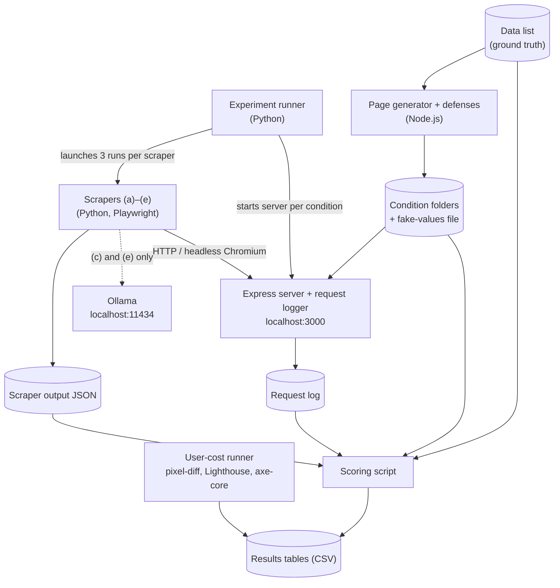

# Benchmarking Defenses Against Web Scrapers

**Benchmarking Defenses Against Automated and LLM-Based Web Scraping: DOM Shuffling, Honeypot Elements, Live DOM Poisoning, and Tarpits**

- **Author:** Joseph Evenson
- **Track:** Blue Track (Research)
- **Status:** In development. Milestone 1 (test site and baseline scoring), Oct 21 – Nov 3, 2026.

This project builds a small local test site and five scrapers of increasing capability, adds simple versions of four page-level defenses, and measures which defenses stop which scrapers and what each defense costs real users in speed, visual fidelity, and accessibility.

> Everything runs locally on one laptop against a synthetic site on `localhost`. No real or third-party websites are scraped, and no personal data is used.

---

## Research question

Which of four page-level defenses (DOM shuffling, honeypot links, live DOM poisoning, and an optional tarpit) stop which of five scrapers of increasing capability, and what does each defense cost real visitors in speed, visual fidelity, and accessibility?

**Hypothesis (capability matching):** a defense lowers a scraper's accuracy only if the scraper lacks the capability that the defense targets. No single defense is expected to stop all five scrapers.

---

## Defenses

| Defense | How it works | Tier |
|---|---|---|
| **DOM shuffling** | Scrambles label and value elements in the HTML source with a seeded shuffle, then restores the on-screen order with the CSS `order` property in a flex layout. | Essential |
| **Honeypot link** | Adds one `display:none` link per page that points to a trap path. Any request to the trap path is logged as a hit. | Essential |
| **Live DOM poisoning** | Puts a same-format fake value in the HTML for each field. A page script waits 2 seconds, fetches the real values from a per-page JSON file, and swaps them in. | Ambitious |
| **Tarpit** | A `/maze/<hash>` route that returns generated filler pages, each linking to more maze pages, with a fixed delay. `/maze/` is disallowed in `robots.txt`. | If time permits |

## Scrapers

| Scraper | How it works | Tier |
|---|---|---|
| **(a) Raw HTML** | HTTP client and HTML parser. Crawls from the home page and takes the text after each label in source order. | Essential |
| **(b) Browser text** | Playwright with headless Chromium. Reads the rendered text right after the load event. | Essential |
| **(c) LLM** | Sends (b)'s rendered text to a local model through Ollama at temperature 0 and parses a JSON reply. | Ambitious |
| **(d) Adaptive** | Playwright. Waits for 3 seconds without DOM changes (10-second timeout), ignores hidden elements, and sorts fields by computed CSS order. | Ambitious |
| **(e) Vision** | Takes a screenshot of each listed page and sends it to a local vision model through Ollama. Follows no links. | Ambitious |

---

## Test site

One data list is the only source of site content and also the answer key for scoring:

- **6 products × 10 fields:** name, brand, category, price, SKU, rating, review count, availability, release date, description
- **2 articles × 5 fields:** title, author, publish date, tags, summary

That gives **70 scored fields**. A page generator turns the data list into a 10-page static site for each condition: `baseline`, `shuffled`, `honeypot`, `poisoned` (plus `tarpit` if built). The home page links to a products page, which lists the 6 product pages, and directly to the 2 article pages. Each item page shows its fields as label-and-value rows. Link text and page titles never contain a scored value, so each value appears only in its own row.

An Express server on `localhost:3000` serves one condition at a time, serves `robots.txt`, and logs every request. Each scraper puts its run ID in the `User-Agent` header as `run=<id>`, so every logged request maps back to a run.

## Architecture



All storage is plain files (JSON, CSV, and logs). There is no database.

| Layer | Technology |
|---|---|
| Test site | Node.js, Express |
| Scrapers | Python, Playwright, an HTTP client and HTML parser |
| Local models for (c) and (e) | Ollama (CPU) |
| User-cost measures | Lighthouse, axe-core, pixelmatch |
| Scoring and analysis | Python (JSON and CSV) |

---

## Metrics

| Metric | Definition | What it answers |
|---|---|---|
| **Accuracy** | correct fields / 70 (missing or malformed fields count as wrong) | Does a defense stop a scraper? |
| **Fake-value rate** | fields equal to that page's fake value / 70 | Was the scraper blocked, or fooled? |
| **Honeypot hits** | trap-path requests that carry the run's ID | Does the scraper follow hidden links? |
| **Time per page** | crawl seconds / pages fetched | How much time does the scraper spend, and what does it cost the server? |
| **User cost** | pixel-diff %, Lighthouse median, axe-core violations, reading-order mismatch rate | What does the defense cost real visitors? |

A defense **stops** a scraper when accuracy falls below 10%. Raw accuracy is always reported as well.

What scrapers write, and how the scoring script decides a value is correct, is defined in [`docs/scraper-output.md`](docs/scraper-output.md).

## Experiment design

- **Grid:** scrapers (a)–(d) on `baseline`, `shuffled`, `honeypot`, and `poisoned`; scraper (e) on `baseline`, `shuffled`, and `poisoned`. That is 19 cells × 3 runs = 57 scraper runs, plus tarpit runs for (a), (b), and (d) if the tarpit is built.
- **Baseline gate:** a scraper must reach at least 90% accuracy on `baseline` before any of its defended runs count.
- **Reporting:** mean and min–max over 3 runs per cell. A difference smaller than the baseline min–max range is not counted as an effect.
- **User cost:** measured once per condition on the same 10 pages, with screenshots taken after a 3-second wait and Lighthouse run 5 times per page (median reported).

---

## Planned repository layout

This layout is a plan and may change during development.

```
data/          data list (ground truth for the site and for scoring)
docs/          specifications, such as the scraper output format
site/          Node.js page generator, defenses, Express server, request logger
scrapers/      Python scrapers (a)–(e)
prompts/       prompt files for (c) and (e)
scoring/       scoring script and its tests
measurement/   experiment runner and user-cost runner
results/       one dated folder per experiment (outputs, logs, CSVs, manifest)
conditions/    generated sites, one folder per condition (rebuilt by the generator, not committed)
logs/          request logs from the server (not committed)
config.json    port, page cap, delays, seeds, number of runs
```

## Setup

Requirements:

- Node.js 20 or newer, and npm
- Python 3 and pip
- Playwright for Python with Chromium (from Milestone 2, for scrapers (b)–(e))
- Ollama, only for scrapers (c) and (e)

Install:

```bash
npm ci
pip install -r requirements.txt
```

## Usage

```bash
npm run generate -- baseline   # writes conditions/baseline/: 10 pages and robots.txt
npm run serve -- baseline      # serves it at http://localhost:3000 and logs to logs/requests.jsonl
npm test                       # checks for the generator and server
```

**Scoring a run** (Python, from the project folder, with the venv active):

```bash
python scoring/score.py <scraper output.json> [--fakes fakes.json] [--records records.csv] [--json]
python -m unittest discover -s scoring/tests -t .   # 24 checks, including the hand-calculated Test 2
```

The scoring rules and the output format scrapers must write are in [`docs/scraper-output.md`](docs/scraper-output.md).

Settings shared by every part (port, page cap, delays, seed, number of runs, trap path) are in `config.json`.

**Run IDs:** a scraper puts `run=<id>` anywhere in its `User-Agent`, for example `bench-scraper (run=a-baseline-1)`. Requests without one are logged as `unknown`.

**Request log:** each request is one JSON line:

```json
{"timestamp":"2026-10-26T20:03:56.672Z","run_id":"a-baseline-1","path":"/products/p3","status":200,"response_ms":2.153,"honeypot_hit":false,"user_agent":"bench-scraper (run=a-baseline-1)"}
```

Steps to run the scrapers and measure user cost will be added as each part is built.

---

## Testing

| Test | What it checks |
|---|---|
| **1. Normal workflow** | Each condition has 10 pages and 70 scored fields, and (a) and (b) reach at least 90% on baseline in every run. |
| **2. Metric calculation** | A 70-field fixture (63 correct, 4 wrong, 3 missing; 2 of the wrong values equal the page's fake, 1 is a malformed price) scores accuracy 0.90 and fake-value rate 2/70 ≈ 0.029. |
| **3. Extraction rule** | The label-plus-next-text rule in (a), (b), and (d) matches hand-worked expected output on baseline, shuffled, and poisoned pages. |
| **4. Shuffle keeps layout** | The same seed produces byte-identical pages, source order differs from baseline, and pixel difference from baseline is at most 1%. |
| **5. Poisoning hides real values** | No real value appears in poisoned HTML. Every field shows its fake at 0 s and its real value at 3 s. |
| **6. Honeypot and logging** | Trap requests log as hits for their run ID, normal requests do not, and a missing `User-Agent` logs as `unknown`. |
| **7. Failure handling** | Crawlers record 404s and timeouts, avoid link cycles, and stop at the page cap. (c) and (e) count invalid model replies as failures without retrying. |

---

## Roadmap

### Milestone 1: Oct 21 – Nov 3 (test site and baseline scoring)
- [x] Data list (6 products × 10 fields, 2 articles × 5 fields)
- [x] Page generator (baseline condition)
- [x] Express server with request logger and `robots.txt`
- [x] Scraper output format and matching rules ([`docs/scraper-output.md`](docs/scraper-output.md))
- [x] Scoring script passes the hand-calculated Test 2
- [ ] Scraper (a) scores at least 90% on baseline in each of 3 runs

### Milestone 2: Nov 4 – Nov 17
- [ ] Scraper (b)
- [ ] DOM shuffling (Test 4)
- [ ] Honeypot link (Test 6)
- [ ] Basic pixel-diff script
- [ ] Baseline check for (a) and (b) (Tests 1 and 3)

### Milestone 3: Nov 18 – Dec 1
- [ ] User-cost runner (pixel-diff, Lighthouse, axe-core, reading order)
- [ ] Essential runs: (a) and (b) on baseline, shuffled, and honeypot, 3 runs each
- [ ] Test 7 for (a) and (b)
- [ ] Stretch: poisoning and scraper (d) (Test 5); setup for (c) and (e)

### Milestone 4: Dec 2 – Dec 10
- [ ] Remaining Ambitious runs (only if ready)
- [ ] Final tables and figure
- [ ] Reproducibility manifest and final README
- [ ] Report PDF
- [ ] Tag the submission commit by Dec 8

**Cut-lines:** if (a), (b), shuffling, and the honeypot aren't working on Nov 17, no Ambitious work starts. Any Ambitious item that isn't running on Dec 1 is dropped and reported as not done.

The day-by-day plan is in [`SCHEDULE.md`](SCHEDULE.md).

---

## Scope and limitations

- **Excluded:** real or third-party websites, personal data, commercial AI agents, CAPTCHAs, rate limiting, IP blocking, fingerprinting, human screen-reader studies, and large-scale crawling.
- **Not generalized:** results describe this site, these local models, and these scrapers only. Both the defenses and the scrapers are written by the same author.
- **Fixed fakes:** each poisoned page carries one fixed set of fake values rather than new values per visit, so the results may overstate how well poisoning works against a scraper that fetches a page twice and compares.

## AI assistance

This project uses AI assistance (Claude). The test site, the measurement tooling, and the setup of scraper (e) (model choice and request format) are drafted with AI assistance. The page defenses, the tarpit route, scrapers (a)–(d), and the prompt, parsing, and failure rules for (e) are written by the author. All AI-assisted code is reviewed, tested against the cases above, and explainable by the author.

Every prompt, question, and design decision made with AI assistance is logged in [`Claude-chat-keeper.md`](Claude-chat-keeper.md), with each decision checked against the midterm plan.

---

## References

1. K. Turk, S. Pastrana, and B. Collier, "A tight scrape: methodological approaches to cybercrime research data collection in adversarial environments." https://www.cl.cam.ac.uk/~bjc63/tight_scrape.pdf
2. R. Tatoris, H. Saxena, and L. Miglietti, "Trapping misbehaving bots in an AI Labyrinth," Cloudflare Blog, Mar. 19, 2025. https://blog.cloudflare.com/ai-labyrinth/
3. Ollama, "API." https://github.com/ollama/ollama/blob/main/docs/api.md
4. Express, "Hello world example," Express.js documentation (v5.x). https://expressjs.com/en/starter/hello-world.html
5. Playwright for Python, "Installation." https://playwright.dev/python/docs/intro
6. GoogleChrome, "Lighthouse." https://github.com/GoogleChrome/lighthouse
7. Deque Systems, "axe-core." https://github.com/dequelabs/axe-core
8. Mapbox, "pixelmatch." https://github.com/mapbox/pixelmatch
