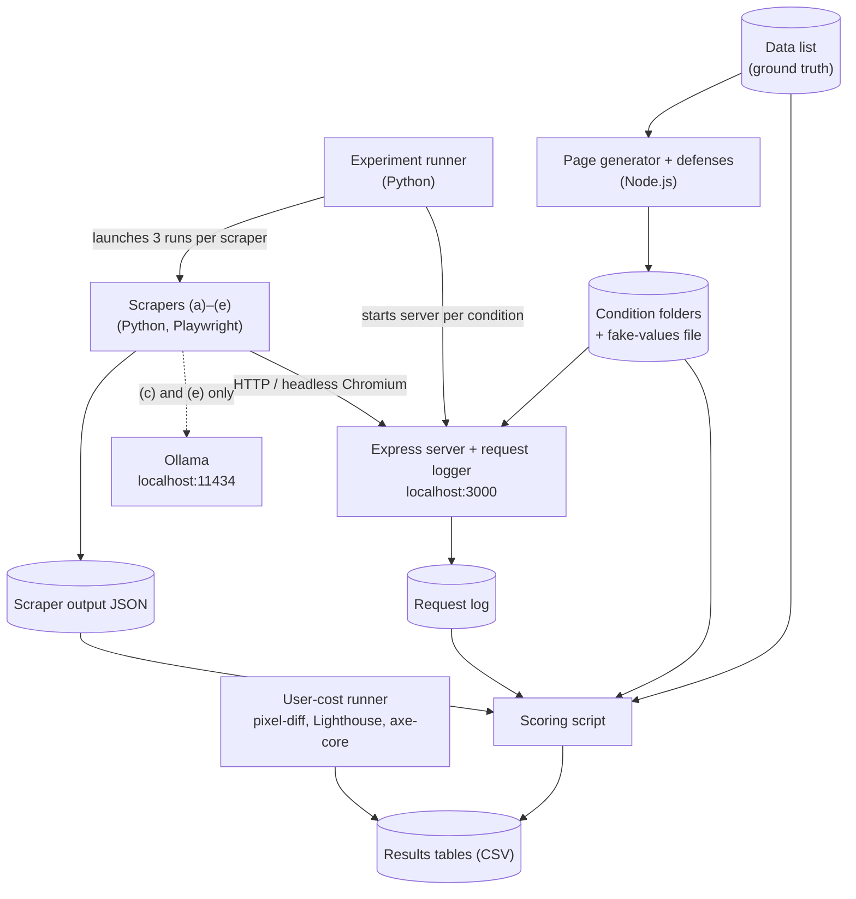

# Benchmarking Defenses Against Web Scrapers

**Benchmarking Defenses Against Automated and LLM-Based Web Scraping: DOM Shuffling, Honeypot Elements, Live DOM Poisoning, and Tarpits**

- **Author:** Joseph Evenson
- **Track:** Blue Track (Research)
- **Status:** In development. Milestones 1 and 2 done (Oct 30, Nov 11). Milestone 3 (Nov 17 – Dec 1) re-planned after the Nov 16 scrum meeting: scrapers (c) then (d), and metrics comparable with published work (see Roadmap). On Nov 18, all ahead of schedule: the Essential runs finished (18/18); scraper (c) passed its baseline check (70/70 in 3 of 3 runs) and ran on all three conditions (shuffling cut it to 48–49/70, against 4/70 for (a) and (b)). On Nov 20 the results CSV, the user-cost measurements and Test 7 were done, which meets Milestone 3's Essential "Done when".

This project builds a small local test site and five scrapers of increasing capability, adds simple versions of four page-level defenses, and measures which defenses stop which scrapers and what each defense costs real users in speed, visual fidelity, and accessibility.

> Everything runs locally on one laptop against a synthetic site on `localhost`. No real or third-party websites are scraped, and no personal data is used.

---

## Research question

Which of four page-level defenses (DOM shuffling, honeypot links, live DOM poisoning, and an optional tarpit) stop which of five scrapers of increasing capability, and what does each defense cost real visitors in speed, visual fidelity, and accessibility?

**Hypothesis (capability matching):** a defense lowers a scraper's accuracy only if the scraper lacks the capability that the defense targets. No single defense is expected to stop all five scrapers.

---

## Defenses

| Defense | How it works | Tier |
|---|---|---|
| **DOM shuffling** | Scrambles label and value elements in the HTML source with a seeded shuffle, then restores the on-screen order with the CSS `order` property in a flex layout. | Essential |
| **Honeypot link** | Adds one `display:none` link per page that points to a trap path. Any request to the trap path is logged as a hit. | Essential |
| **Live DOM poisoning** | Puts a same-format fake value in the HTML for each field. A page script waits 2 seconds, fetches the real values from a per-page JSON file, and swaps them in. | Ambitious |
| **Tarpit** | A `/maze/<hash>` route that returns generated filler pages, each linking to more maze pages, with a fixed delay. `/maze/` is disallowed in `robots.txt`. | If time permits |

## Scrapers

| Scraper | How it works | Tier |
|---|---|---|
| **(a) Raw HTML** | HTTP client and HTML parser. Crawls from the home page and takes the text after each label in source order. | Essential |
| **(b) Browser text** | Playwright with headless Chromium. Reads the rendered text right after the load event. | Essential |
| **(c) LLM** | Sends (b)'s rendered text to a local model through Ollama at temperature 0 and parses a JSON reply. Model: `llama3.2:3b` (chosen Nov 17 after timing three models). | Ambitious |
| **(d) Adaptive** | Playwright. Waits for 3 seconds without DOM changes (10-second timeout), ignores hidden elements, and sorts fields by computed CSS order. | Ambitious |
| **(e) Vision** | Takes a screenshot of each listed page and sends it to a local vision model through Ollama. Follows no links. | Ambitious |

---

## Test site

One data list is the only source of site content and also the answer key for scoring:

- **6 products × 10 fields:** name, brand, category, price, SKU, rating, review count, availability, release date, description
- **2 articles × 5 fields:** title, author, publish date, tags, summary

That gives **70 scored fields**. A page generator turns the data list into a 10-page static site for each condition: `baseline`, `shuffled`, `honeypot`, `poisoned` (plus `tarpit` if built). The home page links to a products page, which lists the 6 product pages, and directly to the 2 article pages. Each item page shows its fields as label-and-value rows. Link text and page titles never contain a scored value, so each value appears only in its own row.

An Express server on `localhost:3000` serves one condition at a time, serves `robots.txt`, and logs every request. Each scraper puts its run ID in the `User-Agent` header as `run=<id>`, so every logged request maps back to a run.

## Architecture



All storage is plain files (JSON, CSV, and logs). There is no database.

| Layer | Technology |
|---|---|
| Test site | Node.js, Express |
| Scrapers | Python, Playwright, an HTTP client and HTML parser |
| Local models for (c) and (e) | Ollama (CPU) |
| User-cost measures | Lighthouse, axe-core, pixelmatch |
| Scoring and analysis | Python (JSON and CSV) |

---

## Metrics

| Metric | Definition | What it answers |
|---|---|---|
| **Accuracy** | correct fields / 70 (missing or malformed fields count as wrong) | Does a defense stop a scraper? |
| **Fake-value rate** | fields equal to that page's fake value / 70 | Was the scraper blocked, or fooled? |
| **Honeypot hits** | trap-path requests that carry the run's ID | Does the scraper follow hidden links? |
| **Time per page** | crawl seconds / pages fetched | How much time does the scraper spend, and what does it cost the server? |
| **User cost** | pixel-diff %, Lighthouse median, axe-core violations, reading-order mismatch rate | What does the defense cost real visitors? |

A defense **stops** a scraper when accuracy falls below 10%. Raw accuracy is always reported as well.

**Standard, comparable metrics** (added after the Nov 16 scrum meeting, so the results can be read against published work). Each is used by a published study; see [`docs/metrics-plan.md`](docs/metrics-plan.md) for the definitions, sources and a related-work table.

| Metric | Definition | Used by |
|---|---|---|
| **Recall, precision, F1** (per field) | Recall = correct ÷ 70 (the same number as accuracy); precision = correct ÷ fields returned; F1 combines them | WebCloak (scraping recall and precision); FreeDOM / SWDE (F1) |
| **Extraction success rate** (per run) | Share of runs with all 70 fields correct | Beyond BeautifulSoup |
| **Relative reduction** | 1 − score with the defense ÷ score without | WebCloak (recall before → after) |
| **Detection, evasion and false-positive rates** (honeypot) | Scraper runs caught ÷ runs; 1 − detection; trap hits by a human-like visitor that clicks only visible links | Shy Guys; FP-Inconsistent |
| **SSIM**, Lighthouse changes, HTML size | Visual similarity to baseline; change in score, FCP, LCP, TTI; page weight against baseline | Wang et al. (SSIM); WebCloak (Lighthouse, HTML size) |

What scrapers write, and how the scoring script decides a value is correct, is defined in [`docs/scraper-output.md`](docs/scraper-output.md).

## Experiment design

- **Grid (as re-planned on Nov 16):** scrapers (a)–(d) on `baseline`, `shuffled`, and `honeypot`: 12 cells × 3 runs = 36 scraper runs. The midterm's full grid (19 cells × 3 = 57 runs) adds `poisoned` and scraper (e); those, and the tarpit, are run only if (c) and (d) finish early, and are otherwise reported as not done.
- **Baseline gate:** a scraper must reach at least 90% accuracy on `baseline` before any of its defended runs count.
- **Reporting:** mean and min–max over 3 runs per cell. A difference smaller than the baseline min–max range is not counted as an effect.
- **User cost:** measured once per condition on the same 10 pages, with screenshots taken after a 3-second wait and Lighthouse run 5 times per page (median reported).

---

## Planned repository layout

This layout is a plan and may change during development.

```
data/          data list (ground truth for the site and for scoring)
docs/          specifications (scraper output format) and the metrics plan
site/          Node.js page generator, defenses, Express server, request logger
scrapers/      Python scrapers (a)–(e)
prompts/       prompt files for (c) and (e)
scoring/       scoring script and its tests
measurement/   experiment runner and user-cost runner
results/       one dated folder per experiment (outputs, logs, CSVs, manifest)
conditions/    generated sites, one folder per condition (rebuilt by the generator, not committed)
logs/          request logs from the server (not committed)
config.json    port, page cap, delays, seeds, number of runs
```

## Setup

Requirements:

- Node.js 20 or newer, and npm
- Python 3 and pip
- Playwright for Python with Chromium (for scrapers (b)–(e); pinned in `requirements.txt`)
- Ollama, only for scrapers (c) and (e)

Install:

```bash
npm ci
pip install -r requirements.txt
python -m playwright install chromium   # downloads the browser Playwright uses (about 150 MB)
```

## Usage

```bash
npm run generate -- baseline   # writes conditions/baseline/: 10 pages and robots.txt
npm run serve -- baseline      # serves it at http://127.0.0.1:3000 and logs to logs/requests.jsonl
npm test                       # checks for the generator and server
```

**Defenses** plug into the generator as one file per condition in `site/defenses/` (for example `shuffled.js` → `npm run generate -- shuffled`). Each page gets a seed from `config.json`, saved in the condition's manifest. See [`site/defenses/README.md`](site/defenses/README.md).

**Scoring a run** (Python, from the project folder, with the venv active):

```bash
python scoring/score.py <scraper output.json> [--fakes fakes.json] [--records records.csv] [--json]
python -m unittest discover -s scoring/tests -t .   # 34 checks, including the hand-calculated Test 2
```

The scoring rules and the output format scrapers must write are in [`docs/scraper-output.md`](docs/scraper-output.md).

**Pixel difference** between a condition and the baseline (Test 4; Node and Python, venv active):

```bash
npm run generate -- baseline
npm run generate -- shuffled
python measurement/screenshots.py baseline --out results/dev/screens/baseline   # 10 full-page PNGs, 1280x800 viewport, 3 s wait
python measurement/screenshots.py shuffled --out results/dev/screens/shuffled
npm run pixel-diff -- results/dev/screens/baseline results/dev/screens/shuffled --diff-dir results/dev/screens/diff --limit 1
python -m unittest discover -s measurement/tests -t .
```

**Test 4** in one command (regeneration hashes, source order, pixel difference; writes `results/<date>-test4/` with `report.md`, the screenshots, `pairs.html` for the by-eye check and a `by-eye.md` to fill in):

```bash
python measurement/test4.py
```

**Test 7**, the crawl part, in one command. It serves a small test site on a free port: a 404 link, a link cycle, and a page that answers only after 12 s, longer than the scrapers' timeout. Each scraper crawls it twice: with page cap 15 it must record the 404 and the timeout, keep going, and visit every page once; with page cap 3 it must stop after 3 pages. It writes `results/<date>-test7/`:

```bash
python measurement/test7.py                      # (a) and (b)
python measurement/test7.py --scrapers a b c     # (c) too (the test pages make no model calls)
```

**Test 6** in one command (starts its own server on port 3100 with a fresh log, sends a trap request and a normal request with run ID `test6` plus one without a User-Agent, and checks the honeypot pages: one hidden trap link each, pixel difference ≤ 1%; writes `results/<date>-test6/`):

```bash
python measurement/test6.py
```

**Test 5** (poisoning hides real values) in one command, once `site/defenses/poisoned.js` exists. It rebuilds `poisoned`, serves it on port 3100 with a fresh log, searches each item page's HTML for its own real values (and the other pages for all 70), and reads each item page in Chromium right after load and 3 s later. Every field should show its fake first and its real value 3 s later. It also checks the fakes file and records when each page swapped; writes `results/<date>-test5/`:

```bash
python measurement/test5.py
```

**Test 3** (the extraction rule): each case in `measurement/fixtures/test3/` is a saved page plus the output worked out by hand (`expected.json`). The script serves each page on its own, runs (a) and (b) on it with `--page-cap 1`, and compares; writes `results/<date>-test3/`:

```bash
python measurement/test3.py
```

**Test 1** (normal workflow): generates baseline, shuffled and honeypot and checks 10 pages and 70 fields in each, then serves the baseline on port 3100 with a fresh log, runs (a) and (b) three times each and scores every run (each must reach 90%); writes `results/<date>-test1/`:

```bash
python measurement/test1.py
```

The screenshots open the generated files directly, so no server is needed. `pixel_diff.mjs` uses pixelmatch with its default settings; if two screenshots differ in size, the extra pixels count as different. `--diff-dir` writes an image per page with the differing pixels marked, for checking by eye.

Settings shared by every part (port, page cap, delays, seed, number of runs, trap path) are in `config.json`.

**Use `127.0.0.1`, not `localhost`, in scraper URLs.** On Windows, the name `localhost` adds about 2 s to every request, which would distort the time-per-page metric.

**Run IDs:** a scraper puts `run=<id>` anywhere in its `User-Agent`, for example `bench-scraper (run=a-baseline-1)`. Requests without one are logged as `unknown`.

**Request log:** each request is one JSON line:

```json
{"timestamp":"2026-10-26T20:03:56.672Z","run_id":"a-baseline-1","path":"/products/p3","status":200,"response_ms":2.153,"honeypot_hit":false,"user_agent":"bench-scraper (run=a-baseline-1)"}
```

**Experiment runner** (venv active; Ollama running if (c) is included):

```
python measurement/run_experiment.py                                   # (a) and (b) × baseline, shuffled, honeypot × 3 runs
python measurement/run_experiment.py --scrapers a b c --out results/2026-11-28-experiment
```

For each condition it rebuilds the site, starts the server on port 3100 with a fresh request log, and runs each scraper 3 times with run IDs like `b-shuffled-2`. It writes `results/<date>-experiment/`:
- `runs/`: each output and what each scraper printed;
- `logs/<condition>.jsonl`;
- `conditions/`: the page lists and seeds;
- `manifest.json`: what ran, exit codes, times, commit, config, tool versions, and Ollama models with digests when (c) runs;
- `summary.md`: a quick accuracy check.

It won't write into a folder that already has files, so earlier runs never get mixed in.

**Results CSV** with the standard metrics, from one or more runner folders (each run must come from only one folder):

```
python scoring/results.py results/2026-11-18-experiment results/2026-11-18-c-all --out results/2026-11-20-results
```

It scores every run with `scoring/score.py` and reads each condition's request log. It writes:
- `results.csv`: one row per run. Accuracy (= recall), precision, F1, complete run, fake-value rate, time per page, page errors, plus page requests, honeypot hits and mean server response time from the log.
- `cells.csv`: one row per scraper and condition. Mean and min–max, extraction success rate, relative reduction against that scraper's baseline, the midterm's verdict (stops, reduces or no effect), the baseline check, and honeypot detection and evasion rates.
- `summary.md`: the cells as a table.

The definitions are at the top of `scoring/results.py` and in [`docs/metrics-plan.md`](docs/metrics-plan.md). A run that crashed is scored as finding nothing and listed as failed.

**User cost** (venv active; run `npm install` once for axe-core and Lighthouse). It compares each condition with the baseline:

```
python measurement/user_cost.py                       # shuffled and honeypot against baseline (about 20 min)
python measurement/user_cost.py --conditions shuffled --lighthouse-runs 1 --out results/dev/user-cost   # a quicker check
```

It opens every page from its files, waits 3 s, and takes a full-page screenshot. It also records where each field's label and value sit on screen. Against the baseline it measures:
- pixel difference;
- SSIM (Wang et al. 2004; 1.0 = identical);
- the reading-order mismatch rate: fields whose label or value is at a different position in the HTML than on screen;
- HTML size per page;
- axe-core accessibility violations, by impact and WCAG level, and how many are new against the baseline;
- Lighthouse (median of 5 runs per page; mobile, simulated throttling, the defaults): performance score, FCP, LCP and TTI as changes from the baseline. For this it serves each condition on port 3200, with its own request log in the results folder, and uses Playwright's Chromium.

It writes `results/<date>-user-cost/`:
- `cost.csv`: one row per condition;
- `pages.csv`: one row per page;
- the screenshots and pixel-diff images;
- `axe-<condition>.json` and `lighthouse-<condition>.json` with every run;
- `report.md` and `manifest.json`.

**Figures and tables** from the results (`pip install -r requirements.txt` adds matplotlib):

```
python scoring/results.py results/2026-11-18-experiment results/2026-11-18-c-all results/2026-11-20-d-all --out results/2026-11-20-results-all
python measurement/figures.py --cells results/2026-11-20-results-all/cells.csv --cost results/2026-11-20-user-cost-full --fields results/2026-11-18-c-all
```

It writes `results/<date>-figures/`:
- `fig1-recall.png`: recall by scraper and site;
- `fig2-reduction.png`: the drop in recall next to WebCloak's published drop;
- `fig3-protection-vs-cost.png`: protection against user cost;
- `fig4-honeypot.png`: honeypot detection;
- `fig5-fields.png`: (c) field by field on the shuffled site;
- `fig6-published.png`: your results next to published ones in the same metrics (drop in recall, success rate, detection rate, load-time cost);
- `tables.md`: Tables 1–4, including the comparison with published work.

**One graph per metric** (recall (accuracy), precision, success rate, drop in recall, detection and evasion rate, SSIM, Lighthouse change, HTML size change), with published values as dashed reference lines where a study reports the same metric:

```
python measurement/metric_graphs.py --cells results/2026-11-20-results-all/cells.csv --cost results/2026-11-20-user-cost-full/cost.csv --out results/<date>-metric-graphs
```

**Cross-check** of the results, recounted from the raw files without the scoring scripts (the matching rules are written again from `docs/scraper-output.md`, and checked first on the hand-counted Test 2 fixture):

```
python measurement/cross_check.py --runs results/2026-11-18-experiment results/2026-11-18-c-all results/2026-11-20-d-all --results results/2026-11-20-results-all --cost results/2026-11-20-user-cost-full
```

It writes `results/<date>-cross-check/report.md`: every check, and the tally for each scraper and defense.

**Model timing for scraper (c)** (Ollama installed and running, at least one model pulled, venv active):

```
python measurement/time_models.py                      # every pulled model, pages p1, p2, a1, 2 timed calls each
python measurement/time_models.py --models gemma3:1b llama3.2:3b --repeats 3
python measurement/time_models.py --no-think qwen3:4b                 # thinking models (Qwen3): answer without writing out reasoning first
```

It reads each page's visible text from the generated baseline site, sends it to Ollama with a fixed timing prompt (temperature 0, replies capped at 400 tokens), and writes `results/<date>-model-timing/`:
- `report.md`: per model, the load time, seconds per page, prompt and reply tokens, the digest, a rough "values found in reply" count, and an estimate for scraper (c)'s 90 page calls;
- `report.json`;
- the raw replies.

The timing prompt is only for comparing speed; scraper (c)'s own prompt is written separately.

Steps to run the scrapers and measure user cost will be added as each part is built.

---

## Testing

| Test | What it checks |
|---|---|
| **1. Normal workflow** | Each condition has 10 pages and 70 scored fields, and (a) and (b) reach at least 90% on baseline in every run. |
| **2. Metric calculation** | A 70-field fixture (63 correct, 4 wrong, 3 missing; 2 of the wrong values equal the page's fake, 1 is a malformed price) scores accuracy 0.90 and fake-value rate 2/70 ≈ 0.029. |
| **3. Extraction rule** | The label-plus-next-text rule in (a), (b), and (d) matches hand-worked expected output on baseline, shuffled, and poisoned pages. |
| **4. Shuffle keeps layout** | The same seed produces byte-identical pages, source order differs from baseline, and pixel difference from baseline is at most 1%. |
| **5. Poisoning hides real values** | No real value appears in poisoned HTML. Every field shows its fake at 0 s and its real value at 3 s. |
| **6. Honeypot and logging** | Trap requests log as hits for their run ID, normal requests do not, and a missing `User-Agent` logs as `unknown`. |
| **7. Failure handling** | Crawlers record 404s and timeouts, avoid link cycles, and stop at the page cap. (c) and (e) count invalid model replies as failures without retrying. |

---

## Roadmap

### Milestone 1: Oct 21 – Nov 3 (test site and baseline scoring)
- [x] Data list (6 products × 10 fields, 2 articles × 5 fields)
- [x] Page generator (baseline condition)
- [x] Express server with request logger and `robots.txt`
- [x] Scraper output format and matching rules ([`docs/scraper-output.md`](docs/scraper-output.md))
- [x] Scoring script passes the hand-calculated Test 2
- [x] Scraper (a) scores at least 90% on baseline in each of 3 runs (70/70 in all three, Oct 30: [`results/2026-10-30-check2/`](results/2026-10-30-check2/))

**Milestone 1 completed Oct 30, four days early.**

### Milestone 2: Nov 4 – Nov 17
- [x] Scraper (b): written by Joseph; first baseline run 70/70 = 1.000, 0.036 s per page (Nov 6: [`results/2026-11-06-b-baseline/`](results/2026-11-06-b-baseline/))
- [x] DOM shuffling (Test 4 passed Nov 10: byte-identical regeneration, source order differs on all 8 item pages, 0.000% pixel difference, 10 pairs checked by eye; [`results/2026-11-10-test4/`](results/2026-11-10-test4/))
- [x] Honeypot link (Test 6 passed Nov 10: trap hit logged for the run, normal page not flagged, missing User-Agent logged as `unknown`; one hidden trap link per page, 0.000% pixel difference; [`results/2026-11-10-test6/`](results/2026-11-10-test6/))
- [x] Basic pixel-diff script (`measurement/screenshots.py` + `measurement/pixel_diff.mjs`; shuffled vs baseline: 0.000% on all 10 pages, Nov 9)
- [x] Baseline check for (a) and (b) (Test 3 passed Nov 11: (a) and (b) match the hand-worked output on the baseline and shuffled pages, [`results/2026-11-11-test3/`](results/2026-11-11-test3/); Test 1 passed Nov 11: 10 pages and 70 fields in each condition, (a) and (b) 70/70 in all 3 runs each, [`results/2026-11-11-test1/`](results/2026-11-11-test1/))

**Milestone 2 completed Nov 11, six days before Cut-line 1.**

### Milestone 3: Nov 18 – Dec 1
Re-planned Nov 16 after the scrum meeting: the LLM scraper (c), then the adaptive scraper (d), come next among the Ambitious work, and the metrics gain standard, comparable measures. See `SCHEDULE.md`.
- [x] Experiment runner (Nov 18: `measurement/run_experiment.py`) and results CSV (Nov 20: `scoring/results.py`, honeypot hits and page requests from the request log)
- [x] User-cost runner (pixel diff and SSIM, Lighthouse, axe-core, reading order). Done Nov 20 (`measurement/user_cost.py`): part 1 pixel diff, SSIM, reading order, HTML size; part 2 axe-core and Lighthouse
- [ ] Standard metrics next to accuracy and fake-value rate (plan: `docs/metrics-plan.md`). Done Nov 20 in `scoring/results.py`: field-level precision, recall and F1, extraction success rate, relative reduction against baseline, honeypot detection and evasion rates. Still to come: the false-positive rate (Nov 29) and HTML size (user-cost runner)
- [x] Essential runs: (a) and (b) on baseline, shuffled, and honeypot, 3 runs each (done Nov 18; planned Nov 23)
- [x] Test 7 for (a) and (b) (crawl part passed Nov 20; planned Nov 24)
- [x] Scraper (c) (Ollama, CPU, `llama3.2:3b`): baseline check passed Nov 18 (70/70 in all 3 runs; deadline Nov 22); runs on all three conditions done Nov 18 (planned Nov 28): shuffled 48–49/70, honeypot 70/70 with the trap visited
- [ ] Scraper (d): written Nov 20 (Claude, at Joseph's request, D99). Baseline check and the runs on all three conditions done Nov 20 (9/9 runs, 70/70 everywhere, the trap never hit); Test 7 passes. Still to do: the (d) part of Test 3 (Nov 25)
- [x] Related-work table, published side, drafted from the papers (`docs/metrics-plan.md`); our side filled Nov 25 and Dec 3
- [x] Poisoning (Test 5), started Nov 23 because (c) and (d) finished early. The site and scoring side is ready (D105): the generator's `fakeValue` and `script` hooks, the real-values JSON, the fakes file, fakes in the results and Test 5. `site/defenses/poisoned.js` written Nov 23 (Claude, at Joseph's request, around his price case; D110). In the cloud it passes Test 5 (4/4), and a one-run preview gave (a) and (b) 70 fakes each and (d) 70/70 real values. Runs done Nov 23 on the laptop (commit `910ee22`, `results/2026-11-23-poisoned-2`; an earlier commit held the draft without the swap, and its runs don't count, D111): (a), (b) and (c) 0/70 with 70 fakes in every run, (d) 70/70 (D112). Test 5 passes on the laptop at the same commit (4/4; the swap at 2.0 s). Results over all 48 runs (`results/2026-11-23-results-all`; cross-check 707/707 agree): poisoning stops (a), (b) and (c) (recall 0%, a 100% drop, fake-value rate 100%) and has no effect on (d) (70/70, 4.65 s per page against 3.03 s). The user-cost runner now serves the pages, so poisoned pages swap, and reports how long the fakes stay on screen (2.02 s in the cloud check, D114). User cost on the laptop (`results/2026-11-23-user-cost-full-2`, D116): 0% pixel difference, SSIM 1.000, 0/70 fields out of order, 0 axe violations, no Lighthouse change beyond noise, HTML +17.5%, fakes on screen 2.0 s. Cross-check with it: 734/734 agree (D117)
- [ ] Tarpit (If time permits), started Nov 23 at Joseph's choice, before the midterm's gate (D106). Hooks are ready (`footer`, `disallow`, `maze`). Still to do: Joseph's `site/defenses/tarpit.js`, then the runner's robots.txt setting, the maze measures and Test 6's maze part
- [ ] Setup for (e)

### Milestone 4: Dec 2 – Dec 10
- [ ] Remaining Ambitious runs (only if ready)
- [ ] Final tables with the standard metrics, and the figure of protection against user cost
- [ ] Related-work comparison and a scope-change section in the report
- [ ] Reproducibility manifest and final README
- [ ] Report PDF
- [ ] Tag the submission commit by Dec 8

**Cut-lines:** if (a), (b), shuffling, and the honeypot aren't working on Nov 17, no Ambitious work starts. Any Ambitious item that isn't running on Dec 1 is dropped and reported as not done.

The day-by-day plan is in [`SCHEDULE.md`](SCHEDULE.md).

---

## Scope and limitations

- **Excluded:** real or third-party websites, personal data, commercial AI agents, CAPTCHAs, rate limiting, IP blocking, fingerprinting, human screen-reader studies, and large-scale crawling.
- **Not generalized:** results describe this site, these local models, and these scrapers only. Both the defenses and the scrapers are written by the same author.
- **Scope change (Nov 16):** after the scrum meeting, the LLM scraper (c) and the adaptive scraper (d) come before poisoning, scraper (e) and the tarpit. Those three are likely to be dropped at Cut-line 2 (Dec 1); if so, the report says so, along with which hypothesis that leaves untested.
- **Comparability:** published studies use real sites, so raw scores are not directly comparable with this synthetic site. Comparisons are made through the same metric definitions and through relative effects (see [`docs/metrics-plan.md`](docs/metrics-plan.md)).
- **Fixed fakes:** each poisoned page carries one fixed set of fake values rather than new values per visit, so the results may overstate how well poisoning works against a scraper that fetches a page twice and compares.

## AI assistance

This project uses AI assistance (Claude). The test site, the measurement tooling, and the setup of scraper (e) (model choice and request format) are drafted with AI assistance. The page defenses, the tarpit route, scrapers (a)–(c), and the prompt, parsing, and failure rules for (e) are written by the author. Scraper (d) was written by Claude at the author's request on Nov 20, a change from the midterm's plan; its first part already used lines Claude supplied (chat-keeper D98, D99). The poisoning defense (`site/defenses/poisoned.js`) was also written by Claude at the author's request, on Nov 23, around the author's own price case; this too is a change from the midterm's plan (D110). All AI-assisted code is reviewed, tested against the cases above, and explainable by the author.

Every prompt, question, and design decision made with AI assistance is logged in [`Claude-chat-keeper.md`](Claude-chat-keeper.md), with each decision checked against the midterm plan.

---

## References

1. K. Turk, S. Pastrana, and B. Collier, "A tight scrape: methodological approaches to cybercrime research data collection in adversarial environments." https://www.cl.cam.ac.uk/~bjc63/tight_scrape.pdf
2. R. Tatoris, H. Saxena, and L. Miglietti, "Trapping misbehaving bots in an AI Labyrinth," Cloudflare Blog, Mar. 19, 2025. https://blog.cloudflare.com/ai-labyrinth/
3. Ollama, "API." https://github.com/ollama/ollama/blob/main/docs/api.md
4. Express, "Hello world example," Express.js documentation (v5.x). https://expressjs.com/en/starter/hello-world.html
5. Playwright for Python, "Installation." https://playwright.dev/python/docs/intro
6. GoogleChrome, "Lighthouse." https://github.com/GoogleChrome/lighthouse
7. Deque Systems, "axe-core." https://github.com/dequelabs/axe-core
8. Mapbox, "pixelmatch." https://github.com/mapbox/pixelmatch
9. X. Li, T. Qiu, Y. Jin, L. Wang, H. Guo, X. Jia, X. Wang, and W. Dong, "WebCloak: Characterizing and Mitigating the Threats of LLM-Driven Web Agents as Intelligent Scrapers," IEEE S&P 2026. https://web-cloak.github.io/
10. A. Bhardwaj, N. Diwan, and G. Wang, "Beyond BeautifulSoup: Benchmarking LLM-Powered Web Scraping for Everyday Users," arXiv:2601.06301, 2026.
11. B. Y. Lin, Y. Sheng, N. Vo, and S. Tata, "FreeDOM: A Transferable Neural Architecture for Structured Information Extraction on Web Documents," KDD 2020.
12. R. Van Boxem, T. Barbette, C. Pelsser, and R. Sadre, "Shy Guys: A Light-Weight Approach to Detecting Robots on Websites," arXiv:2603.28546, 2026.
13. H. Venugopalan, S. Munir, S. Ahmed, T. Wang, S. T. King, and Z. Shafiq, "FP-Inconsistent: Measurement and Analysis of Fingerprint Inconsistencies in Evasive Bot Traffic," arXiv:2406.07647, 2025.
14. Z. Wang, A. C. Bovik, H. R. Sheikh, and E. P. Simoncelli, "Image Quality Assessment: From Error Visibility to Structural Similarity," IEEE Transactions on Image Processing, 13(4), 2004.
